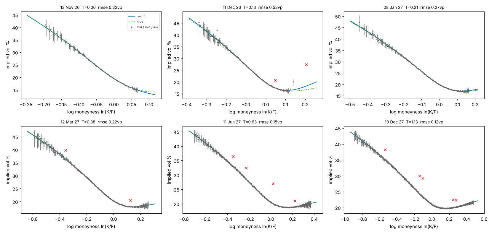
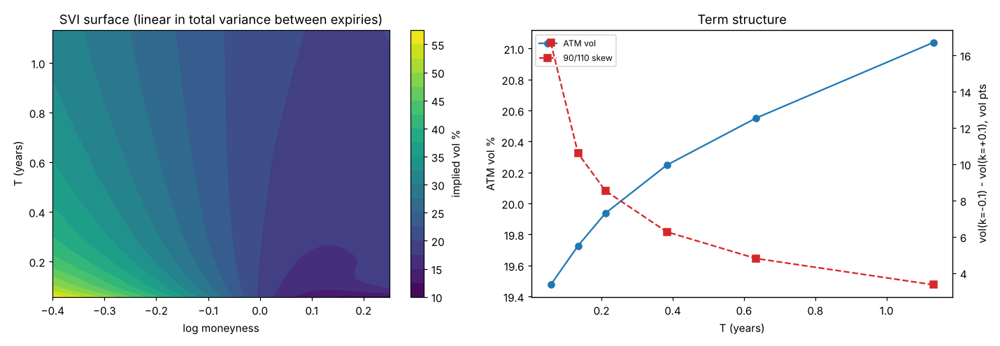

# vol-surface-svi

Fits an implied volatility surface to an index option chain using raw SVI, one expiry at a time, and checks the result for static arbitrage. A market maker's pricing and risk both sit on top of a surface like this, so a bad wing or a calendar crossing turns straight into bad quotes or wrong greeks.

## Pipeline

1. Clean the chain: drop zero bids and crossed or locked markets.
2. Forward and discount factor from put call parity: C - P = df(F - K) is a straight line in K, fitted with Theil-Sen near the money so a single stale quote can't move the forward much. On the sample chain the implied forwards land within 0.06% of the true ones.
3. OTM implied vols from mid, bid and ask (Brent root finding, NaN if the price is outside no arbitrage bounds).
4. Raw SVI fit per expiry: weighted least squares on total variance, weights of 1 / bid ask width in vol so the tight ATM quotes count more than the wide wings, several random starts, then one outlier pass (anything more than 3x its own half spread from the first fit is dropped and the slice refitted).
5. Arbitrage checks
   * butterfly: Durrleman's g(k) ≥ 0 on k in [-1, 1]
   * calendar: total variance non decreasing in T at every k
6. Surface: linear interpolation in total variance between expiries.

## The arbitrage issue I hit

The first version fitted each slice freely. On the sample chain the Dec 26 slice came out with butterfly arbitrage in the call wing and rose above the Jan 27 slice in total variance around k = 0.6, outside the quoted range but still a problem if anything gets priced there. The Dec call wing has only a few quotes past the money (most far OTM calls have a zero bid and get dropped), so the fit had a lot of freedom out there.

The fix was to add soft penalties to the least squares: one on g(k) going below a small buffer on a wide k grid, and one on total variance dropping below the previous expiry's. Expiries are fitted shortest first so each one can be held above the last. After that every slice passes both checks and the Dec fit error actually went down slightly (0.56 to 0.53 vol points RMSE).

## Results on the sample chain

Synthetic NKY chain for 23 Oct 2026, 6 expiries, 2,916 quotes generated from a known SVI surface with wider spreads in the wings, mid noise, zero bids and ~1% stale quotes (`data/make_chain.py`).

| expiry | T | RMSE (vol pts) | % of fit inside bid/ask | outliers removed |
|---|---|---|---|---|
| 13 Nov 26 | 0.06 | 0.32 | 100 | 0 |
| 11 Dec 26 | 0.13 | 0.53 | 98.4 | 2 |
| 08 Jan 27 | 0.21 | 0.27 | 100 | 0 |
| 12 Mar 27 | 0.38 | 0.22 | 100 | 2 |
| 11 Jun 27 | 0.63 | 0.15 | 100 | 4 |
| 10 Dec 27 | 1.13 | 0.12 | 100 | 5 |

Against the true surface the fit is within 0.25 vol points over the quoted range on every expiry except Dec 26, where one stale call quote sits inside its own (wide) spread band, survives the outlier pass and pulls the far wing up by about 1.5 points. A better outlier rule would compare against neighbouring strikes rather than the quote's own spread.





## Running

```
pip install -r requirements.txt
python -m pytest
python -m volsurface data/nky_chain_2026-10-23.csv --asof 2026-10-23 --truth data/true_svi.csv
python -m volsurface data/nky_chain_2026-10-23.csv --asof 2026-10-23 --no-arb-penalty   # see the arb come back
```

Plots go to `out/smiles.png` and `out/surface.png`.

## Still to do

* SSVI or another parametrisation that is arbitrage free by construction instead of by penalty
* American exercise (fine for European index options, not for single stocks)
* time series of fits so the parameters can be checked for stability day to day

---

If something here is unclear, broken, or just wrong, feel free to open an issue. I'm always happy to chat about it.
